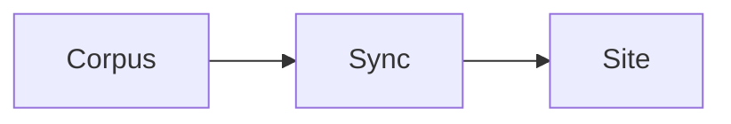

# Callouts and diagrams

> [!NOTE]
> A GitHub alert becomes a callout.

> **A lead-in sentence.** This stays a plain quote.



| Column | Value |
| --- | --- |
| One | 1 |

```ts avoid
const value = 1 as unknown as string;
```

```ts recommended
const value = "1";
```
